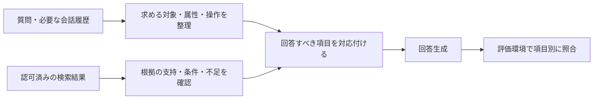

# 質問の要求項目と回答漏れを分けて扱う設計

2026-10-14。rag-wip。前回のA/C候補は不採用のまま、runtimeのv1出力を維持する。今回は評価専用の要求項目台帳・レビュー形式・限定書式probe・既存回答のoffline再評価を実装した。本番の質問解析器や回答修正機能はまだ実装していない。

## 今回分かったことと目的

数値そのものが合っていることと、質問へ必要な説明をすべて返すことは別である。既知の比較問題では、E=5時間/F=7時間は書けていても「Fが2時間長い」が抜けた。原因がpromptの長さや特定の文にあるとは、前回の少数比較だけでは断定できない。

今後は、要求する操作と根拠の支持範囲を分けて確認する。例えば「時間・価格を比較してお得な方を教えて」なら、次の項目を別々に扱う。

| 要求項目 | 根拠の状態 | 必要な回答 |
| --- | --- | --- |
| 対象ごとの時間 | 両対象に既知値 | 対象と単位を対応させて提示 |
| 時間の差 | 記載値の比較を許可できる場合 | 方向と差を明示。単に2数値を並べて済ませない |
| 対象ごとの価格 | 片側だけ不明 | 既知価格と不明な対象/属性を区別 |
| お得な方 | 比較に必要な価格が不足 | 決定できない理由を答え、価格や推薦を補完しない |

ただし、測定条件が異なる性能値を、同じ条件の優位性として比較しない。差分を要求項目へ加える前に、その比較が許されるかを確認する。条件不明を同条件と認定せず、差分を禁止する場面では「比較不能の理由」が必要項目になる。記載値の算術差・同条件性能・総合推薦は同じ操作ではない。

## 実装済みの評価用構成

`mcp-server/scripts/rag-quality/answer-coverage.mjs`:

- 開発30問×2styleの60台帳を生成。元claim ID、kind/dimension、期待内容、根拠page/quote、bank/rubric/inputの版を保持する。共通/style基準は適用性のreviewを求め、goldの必須項目や禁止事項と区別する。
- 60台帳には計552行あるが、元の複合claim/共通規則を含む整理用の行数である。552個の独立した能力を検証した意味ではない。元goldは人間確認pending。既存の複合claimを十分に原子的な項目へ分割できているとは主張しない。
- 回答は `satisfied / omitted / incorrect / unsupported / pending / not_applicable` で項目別にレビューする。回答が触れた件数と正しく満たした件数を分ける。未提出・空review・pendingは成功にしない。goldの必須項目はN/Aへ隠せない。
- satisfied/incorrect/unsupportedは回答quoteとUTF-16 offsetを検証。欠落には引用できる文章がないため、全回答を確認した範囲・理由・review担当を記録する。禁止違反がない等のabsence判断も全回答scanを記録する。
- answer/contract hashでreviewを紐付け、別回答への流用や改変されたquoteを拒否する。引用の原文一致やreview担当のラベルは、意味的正しさや本人性の暗号学的保証ではない。人/独立AI reviewerが意味を判断する。
- 自動補助probeの結果からreviewを自動的にsatisfiedにしない。`contentAccepted`は入力されたreviewの集計に限り、`releaseAccepted`は常にfalse。評価者の誤り・gold未確認・本番の安全性を合格扱いしない。

gold/期待値/採点文言は評価専用で、生成モデルへ渡す機能はない。本番モジュールからimportせず、キー読取・ネットワーク・DB・課金・新しいlive入口は追加していない。未使用20問は台帳の生成対象に含めず、モデルへも送っていない。

### 限定書式の差分probe

対象・差分・単位・方向・比較許可は、人手oracle側で設定する。質問や資料からこれらを自動推定する機能ではない。製品名や「点灯」という語を分岐条件にせず、配送時間や料金でも同じ有限書式を使う。

- 「配送Yは配送Xより24時間遅い」「プランQはプランPより300円安い」等はexplicit_candidate。
- 数値を並べるだけならomission_candidate。
- 否定・仮定・引用・逆方向・誤数値/単位・複数候補・表・別表現・比較許可なしはneeds_review。正規表現で自由文を完全に解釈しない。
- どの結果も合格/欠落の確定ではない。対応は正の整数差と限定単位/日本語構文。単位換算・小数・未知の言い換え・科学的正しさの汎用判定は未対応。誤候補/見逃しはあり得る。

## 前回回答の再確認

`answer-coverage-replay.mjs`が、前回4runの固定private journalを、ファイルhash・record chain・全6件完了・不明送信なしを確認して読取る。任意パス/資料をCLIで受け取らず、答え本文やquoteを出力しない。新しい生成・API費用なし。

24回答のうち差分要求のある8回答だけを対象にした。前回の独立内容レビューに基づく注釈を `answer-coverage-reviews.json` に、回答hash・quoteのoffset/hash・全回答scanとして保存。raw回答/quote本文はprivateのみ。既存報告やgoldを変更・再採点しない新しい分析である。

| 見方 | 結果 |
| --- | --- |
| 独立reviewで差分を確認 | 5件 |
| 独立reviewで差分の欠落を確認 | 3件 |
| 書式probeの明示候補 | 3件 |
| 書式probeの欠落候補 | 3件 |
| 書式probeでは要review | 2件（reviewでは差分あり） |

既知の欠落3件は候補として拾えたが、8件での校正に過ぎず汎用の検出精度ではない。合法的な回答中の引用等に保守的に反応して、明示候補へ上げなかったものもある。他の要求項目はこの分析ではpendingとし、8回答全体を合格へ昇格させていない。これによって回答自体が改善したわけではない。

本文なし結果は [RAG_ANSWER_COVERAGE_RESULTS.json](RAG_ANSWER_COVERAGE_RESULTS.json)。レビュー構造/差分候補/適用性/対象/否定/未知書式/quote改変等を専用テストで検証する。

## 次に試す本番設計案（まだ未実装）

1. 質問側の計画は、事実確認/説明/計算/条件/比較/要約の組合せと、対象・属性・要求操作・質問中の根拠spanを持つ。全質問を一種類に押し込めず、不明な分類は共通方針へ戻す。
2. 根拠側は別に、対象/属性ごとのsupported/unknown/conflict/unsupported形式、単位/条件/期間を扱う。質問に要求があるだけで、比較や計算を許可しない。
3. 生成へ渡すのは、実際の質問・認可済み本文から作った計画である。今回の手書きgold・正解値・評価case IDを渡したり、ID/固有名別の本番分岐を作ったりしない。構造化出典はserver側を維持する。
4. 計画の自己申告や生成したcovered ID一覧だけで回答成功としない。モデルが質問項目を落とせば後段も見逃すので、要求抽出の漏れと回答生成の漏れを独立に採点する。今回の人手台帳はその比較用oracleで、まだ完成した抽出器ではない。
5. source_onlyは資料にない背景を追加しない。explainは理解に必要な背景を区別して許可する。資料の事実の言い換えを不要に拒否せず、未知固有値を補完しない。0hit/障害の通常chat契約も維持する。
6. まずofflineで質問計画の候補を作り、分野が異なる別題（料金/配送/計算/条件例外/解説等）で人手oracleと比較する。単純な語の一致だけを汎用抽出と呼ばない。追加分類APIを既定にせず、必要性・費用・待ち時間を測って選ぶ。

将来runtimeの生成後検証を採用する場合は、送信前buffer/最大呼数/タイムアウト/再認可/クレジット/キャンセルを別のHigh設計で確認する。今回は実装しない。判定できない書式をそのまま拒否・再生成させる運用もしない。

受入条件は、別分野の複合質問で要求抽出漏れを可視化し、既存必須成功・条件/例外・目的別背景説明を保持し、判定不能を合格や欠落に変換しないこと。人間gold確認前、少数probe、コードテストだけで公開可としない。第2段階全体は未完了。

今回の評価は[OpenAI公式の評価指針](https://developers.openai.com/api/docs/guides/evaluation-best-practices)の項目別採点/評価器自身の検証を参考にした。OpenAIの評価サービスを呼び出したものではない。

## 検証・引き渡し

専用9テスト・関連24テスト成功。最終Worker全体1,317テスト成功、失敗/skip 0（44.6秒）。最終ログは `/private/tmp/studiquo-rag-coverage-all-final.log`。独立対象16テスト成功、8回答の注釈も原回答と照合して再確認した。独立レビューのLow指摘（質問文/命令文/後続の逆方向訂正も明示候補にする場合）を修正し回帰テストを追加。未解決のHigh/Medium指摘なし。構文・差分・新規ファイル空白確認済み。

runtimeの77通り出力はv1と同一、旧報告/rubric/bankも不変。追加API送信0・追加API費用0。実iPad/PDF/OCR/新しいモデル生成/分類精度の評価は今回行っていない。コードテスト1,317件を質問正答件数や回答精度と呼ばない。

本番コード/prompt/flags/DB/secret/iOS/公開状態は不変。deploy/commit/push/mergeなし。採用済み構成を変更していないため、Projectの資料の更新: なし。

## 2026-10-15 原文引用から位置を決める評価用v3候補

subjectの引用位置不一致を受け、[v3設計](RAG_QUOTED_PLAN_V3_DESIGN.md)とpure schema/resolverを評価専用に追加した。モデルは数値offsetでなくtextと直前/直後の引用を返し、serverは完全一致する場所が一つの場合だけ位置に変換する。複数/無一致/Unicode不正/余剰fieldは固定エラーにし、推測・fuzzy・正規化・v2失敗の救済をしない。元v2 validatorによる最終検証を維持する。

独立設計/コードレビュー完了。Medium（敵対的例外Proxyのinstanceofから任意errorが漏れる経路）をWeakMap内部エラー識別に修正し、再レビューで未解決High/Mediumなし。専用13テストと、既存開発8問13scopeのoracle位置へのround-tripを確認。ただしモデル抽出の成功率/回答精度は未評価。今回追加API/キー読取0、3つの失敗runのlock/旧v2/本番v1/未使用20問不変。

次はこのv3専用の質問だけを渡すrequest/response bindingをオフラインで整備する。元のpaired request/parser/runnerへ黙って差し替えず、新contract versionで分離する。API評価はその後の有限予算/manifest/独立安全確認の単位として扱い、既存失敗runの解除・再送をしない。全Worker結果はv3設計書の最終記録を参照。Projectの資料の更新: なし。

2026-10-15 v3失敗後のoffline検討：[RAG_QUESTION_UNIT_PLAN_DESIGN.md](RAG_QUESTION_UNIT_PLAN_DESIGN.md)。既存A厳密引用を基準として凍結保持し、B fuzzy/正規化救済は不採用。C質問unit ID+role別解釈ラベルの別v4契約を設計し、独立Plannerレビューで未解決High/Mediumなし。原文lossless復元・questionHash binding・既知ID/型上限の形式検証と、ラベル/role/要求分割の意味評価を分離する。正しいIDで架空ラベルや全role同参照が形式合格し得る負例を残し、ID coverageを意味recallとしない。各role参照数/byte上限での表現不能も別集計する。境界規則/Unicode/上限は次のpure preprocessor実装前に固定する小契約として未完了。
今回コード/API/キー読取0、テスト再実行なし。旧4runのsource/journal/lockを保持し、失敗fieldが分かったと主張せず再送もしない。本番v1/未使用20問不変。次はunit境界の最小契約とpure preprocessor/反例をoffline実装し、その後v4 schema/validator/人手oracle意味比較へ進む。モデル品質改善・本番採用は未確認。Projectの資料の更新: なし。

2026-10-15 v4 schema/validator：[RAG_UNIT_TASK_PLAN_V4_CONTRACT.md](RAG_UNIT_TASK_PLAN_V4_CONTRACT.md)で別評価契約を実装。案のrole参照4上限を既知unit数まで（max64）に拡張し、5unit以上も表現可能にした。task16/subject4/condition4/label256UTF16/plan32KiB等の上限は残る。JSON文字列のみを検証し、質問からunitを再生成してhash/既知ID/形/status/unknownを照合する。原文は共通table一度だけ、展開結果256KiB以内。正しいIDでも架空label/誤role/過剰参照が形式合格し得る負例をpendingとして保持する。
対象14/全Worker1450/独立14成功、High/Mediumなし。API/キー読取0、凍結source/4失敗runlock保持、本番v1/未使用20問不変。次はラベルとrole対応の独立意味評価規約・既存oracleとの一対一照合を準備し、その後v4質問のみrequest/responseへ進む。形式合格/ID coverageを意味精度としない。モデル品質改善は未評価。Projectの資料の更新: なし。

2026-10-15 v4独立意味review集計：[RAG_UNIT_PLAN_SEMANTIC_REVIEW.md](RAG_UNIT_PLAN_SEMANTIC_REVIEW.md)。外部reviewの8観点を受け、承認/可能graphの最大一対一matchingからoracle相対missing/extra上下限を集計する。未reviewを誤り扱いせず、unsupported/uncertainも母数に保持。形式合格と意味合格、提出reviewと本人性保証を区別し、humanReview/releaseは未承認のまま。対象17成功（全81の2×2graph）、全Worker1466成功（追加16まで、最後の総当たり1件は対象のみ）、独立16成功・High/Mediumなし。開発8問/13要求は合成reviewの集計roundtripだけでモデル品質ではない。API/キー読取0、本番v1/未使用20問/旧4runlock保持。Low残件はreview hash出力の追跡性で、元review/artifactは呼出元で保持する。次はoracle/reviewをimportしないv4質問のみrequest/response bindingをoffline実装する。Projectの資料の更新: なし。

2026-10-15 v4質問のみ入出力：[RAG_UNIT_PLANNER_IO_REPORT.md](RAG_UNIT_PLANNER_IO_REPORT.md)。固定開発8問からquestion/hash/server unit(id,text)を送るbodyをoffline生成し、v4版/既知ID/schema、completed/usage/refusal/byte/原文tableを検証する新request/responseを追加。oracle/review/offset/期待taskの送信なし、scope5規則/Luna medium保持、旧v2/v3 source不変、意味pending/releasefalse。対象9/全Worker1476/独立9成功、High/Mediumなし。cloneテストLow修正後対象再実行成功。合成13taskのmockは実モデル精度ではない。API/キー読取0、本番v1/未使用20問/旧4lock/v3journal hash保持。32KiB requestは旧24KiB runner互換ではなくそのまま接続しない。次は別v4有限run設計・予算/段階意味review/初失敗停止/診断privacyの独立安全gateへ進む。Projectの資料の更新: なし。

2026-10-15 v4有限run設計：[RAG_UNIT_PLANNER_LIVE_DESIGN.md](RAG_UNIT_PLANNER_LIVE_DESIGN.md)と24件の[LIVE_TEST_MATRIX](RAG_UNIT_PLANNER_LIVE_TEST_MATRIX.md)を追加。固定8問1+3+4/予約8192microUSD毎回・65536合計（実請求上限ではない）/32KiBbodyを別v4runとして設計。外部8観点reviewの全case reviewed_matchだけcontinue、private artifact保持と全先行stageをlive自身が予約前に再評価、同一fd検証、共通lock/O_EXCL/fsync順/孤立artifact停止、復号後秘密反射拒否を必須化した。独立PlannerのMediumと安全5条件を反映し最終High/Mediumなし。公式Luna料金2026-10-15再確認、実行直前も再確認する。今回設計のみ、コード/テスト実行/API/鍵読取0。文書リンク/24行/diff/旧v3sourcehashを確認。直近全Worker1476成功は前工程の結果。次は新v4journal/replay→review artifact gateをoffline実装し、その後transport/mock/独立code安全gateへ進む。本番v1/未使用20問/旧4runを保持。Projectの資料の更新: なし。

2026-10-15 v4 journal/元review gate：[RAG_UNIT_PLANNER_JOURNAL_REPORT.md](RAG_UNIT_PLANNER_JOURNAL_REPORT.md)。別offline manifest（transportAttached:false）でv4保存plan/provenanceを固定質問から再生成し、独立reviewの元JSONをprivate stage artifactへ保持。共通lock/O_EXCL/file→dir→journal fsync、全先行stageをopen/予約前に同一fdで再評価、孤立/欠損/改変/秘密でない固定reason/unknownを保持。continueは全case reviewed_matchのみ。対象21/全Worker1497/独立code21・安全21成功、High/Mediumなし。API/鍵読取0、旧v3source/journal hashと4runlock保持、本番v1/未使用20問不変。人間oracle確認pendingとモデル意味品質未評価を維持。24matrixのtransport項目を完了したとは扱わない。次はbounded transport（decode後秘密反射・deadline・固定診断）の実装と独立安全gate。新transport manifestを固定しofflineテストrunを転用しない。Projectの資料の更新: なし。

2026-10-15 v4秘密反射pure helper：[RAG_UNIT_PLANNER_SECRET_GUARD_REPORT.md](RAG_UNIT_PLANNER_SECRET_GUARD_REPORT.md)。使用枠95%・並行作業なしを確認し、完結可能な小単位としてraw/JSON1段復号後の全string/property名を検査するguardを追加。256KiB/深さ64/node65536、固定error/戻りundefined、IO/logなし。対象7/全Worker1503（追加6まで・最後の多重JSON1件は対象のみ）/独立コード安全7成功、High/Mediumなし。多重JSONはraw単独で十分でなく、request/rawresponse/最終parser保存対象の3箇所適用を次transportの必須条件にした。今回API/鍵読取0、旧v4offline source/manifest不変、transport/journalへ未接続・保存経路安全性/モデル品質未評価。次はbounded transport/deadline/bodycancel/固定診断/3箇所guardを実装し新manifestで独立gate。上限到達時は切替/reset回避せず次回へ。Projectの資料の更新: なし。

2026-10-15 v4 bounded transport：[RAG_UNIT_PLANNER_LIVE_REPORT.md](RAG_UNIT_PLANNER_LIVE_REPORT.md)。通常枠回復/並行作業なしを確認して新live/live-journal/live-reviewを分離追加。別suite/manifestv2/全16source固定で旧offlineを拒否、1+3+4/予約/全先行review再評価、deadline/bodycancel/固定phase/status/reasonを実装。request/raw response/最終parser保存JSONの3guardでUnicode escape/二重JSON秘密反射をcompleted前に拒否する。対象live15+journal21=36/全Worker1540/独立code36・安全43（guard7含む）成功、High/Mediumなし。旧v3/v4offline source/journal hashと4runlock保持、本番v1/未使用20問不変。今回はAPI/実キー読取0、実run未作成、モデル/schema品質未評価。次は公式料金/仮定/最終source・manifest/新canonical directory未使用をpreflightし、新v4 stage0の1問だけ実評価。独立意味review後だけ後続stage、初失敗停止/別dir自動再送なし。Projectの資料の更新: なし。

2026-10-16 v4実API評価：[RAG_UNIT_PLANNER_API_RUN_REPORT.md](RAG_UNIT_PLANNER_API_RUN_REPORT.md)。公式料金/通常枠/固定manifest/sourceと旧lockを確認して新run `/private/tmp/studiquo-rag-unit-v4-20261016-01` を1+3+4で実行。8送信/8形式完了/通信形式エラー0、独立意味監査7問reviewed_match・index5だけmismatch_detected。条件/例外の2要求はattribute内に残るが明示対象をsubjectsへ出さないrole欠落であり、情報全消失と混同しない。stage0/1実監査continue登録後だけ後続へ、stage2最終stop登録・lock保持。generationComplete=true/finalReviewComplete=false。最終23record/hash `fd486aa7e2a4b3d5015b0a2245584c8553c667ed4557ae9a444a433122abfd2f` を独立安全監査。予約65536microUSD、usage料金推計0.00231765USD（請求不明）、要求抽出中央値4.200秒/最大7.318秒。全8問1unitで複数unit未評価、人間gold pending、7/8を汎用精度としない。本番v1/未使用20問不変、旧4+新stopの計5runを再開/解除/別path自動再送しない。今回コード変更なし・テスト再実行なし（直近全Worker1540成功）。次は [RAG_UNIT_PLANNER_ROLE_FOLLOWUP.md](RAG_UNIT_PLANNER_ROLE_FOLLOWUP.md) の汎用role修正候補と別題/複数unit/対象不在・名詞過抽出の開発oracleを先に固定する。現source/prompt/run凍結、追加APIは別有限設計gate。Projectの資料の更新: なし。

2026-10-16 subjects修正候補：[RAG_SUBJECT_ROLE_CANDIDATE_REPORT.md](RAG_SUBJECT_ROLE_CANDIDATE_REPORT.md)。通常枠/並行作業なしを確認し、先に別開発12問/14要求oracleを独立確認（10multiunit・全7operation・subjects空2）。背景名詞/条件と対象/別対象別属性/対象名中operation語の負例を含む。質問とoracleを分離・hash bindし、人間gold pending維持。その後、旧v4指示そのままbaselineと汎用subject保持4規則だけ追加candidateの固定requestを別moduleへ追加。schema/model設定は同一、24bodyhash/clone/index+variant/32KiBを検証、oracle/reviewのmodel入力なし。対象8/全Worker1548/独立code8成功、oracle注釈High/Mediumなし。API/鍵読取0、精度改善・新schema実受理は未評価、計算operand意味/task bindingも対象外。旧source/prompt/stop journal hash・計5runlock保持、本番v1/未使用20問不変。次は新12問×2variantの応答bindingと別有限比較runの予算/段階review/停止設計。旧8問runnerへそのまま接続せず旧run再送なし。Projectの資料の更新: なし。

2026-10-16 paired応答binding/High設計：[RAG_SUBJECT_ROLE_RESPONSE_REPORT.md](RAG_SUBJECT_ROLE_RESPONSE_REPORT.md)。新parserは固定index/variant/observedRequestHash/rawの4引数で実送信contextを期待bodyhashに照合し、同質問の版違いを復号前に拒否。local bindingは上流実行証明ではない限界も回帰した。対象8/全Worker1556/独立code8成功。別High設計は12pair24送信（偶奇順・stage2/6/8/8、予約196608microUSDで実請求上限ではない）。確定baseline意味不適合のみ比較継続を許し、技術失敗/候補不適合/未知は停止、partial/prefix件数を分離する。Planner指摘の同一plan時arm bindingを提出packetId/hash+固定mappingで補強し、元review/packet collection再検証・packets_readyとcontinue分離を21予定回帰へ記録。最終Planner/安全High/Mediumなし。今回API/鍵0、paid runner未実装、改善精度未評価。旧candidate sourceとstop journal hash/5lock、本番v1/未使用20問保持。次は新24job manifest/journal/replay→中立packet/review gateをoffline実装、旧runへ流用しない。Projectの資料の更新: なし。

2026-10-16 paired台帳のoffline切出し：[RAG_SUBJECT_ROLE_LEDGER_REPORT.md](RAG_SUBJECT_ROLE_LEDGER_REPORT.md)。24job/偶奇順/4段階上限/source closureのmanifestとstage0のみNDJSON replayを追加。transport/persistence/reviewGateAttached=false・maxExecutableStage=0で、まだファイル保存・lock・review受付・送信なし。予約/完了/技術失敗/review待ちを再計算し、片側完了をpartial、比較済みは0のまま、予約/途中pairのreopen不可・stage1/review文字列拒否を検証。独立Medium（0完了でも予約済みpairを未着手へ数える）をreservedPairs/unreservedPairsへ分離修正し、最終コード/安全各12成功・High/Mediumなし。API/鍵0、実モデル品質未評価、旧candidate sourcehash/停止journalhash/5lock保持、本番v1/未使用20問不変。次はprivate file/共通lock/O_EXCL/fsyncの保存wrapper→中立packet/mappingと元review gate→transportを実装。今回のoffline台帳をpaidrunへ転用しない。全Workerの最終結果は専用report/resultsを参照。Projectの資料の更新: なし。

2026-10-16 paired stage0保存：[RAG_SUBJECT_ROLE_JOURNAL_REPORT.md](RAG_SUBJECT_ROLE_JOURNAL_REPORT.md)。旧pure ledgerを無変更でouter persistence manifest+inner ledgerとして保存するwrapperを追加。別offline suite、0700/0600・共通lock/O_EXCL・同一fd有界read・前後stat・全byte/source照合・fsync完了後だけ予約成功。初期/first-pair正常checkpointだけ再開、予約/partial/failed/poisonはlock保持。stage1/review/packet/transportは未接続。対象14回帰にclose故障/読取中差替えを含む。コード/安全の独立確認High/Mediumなし、最終テスト件数はreport/results参照。API/鍵0、旧candidate/ledger sourcehash・停止journalhash/5lock保持、本番v1/未使用20問不変。次は中立packet/mapping・元review artifactと全先行再評価gateをoffline実装し、その後transportを新manifestへ接続する。今回のoffline runをpaidrunへ転用しない。Projectの資料の更新: なし。

2026-10-16 paired中立packet：[RAG_SUBJECT_ROLE_PACKETS_REPORT.md](RAG_SUBJECT_ROLE_PACKETS_REPORT.md)。stage0完了ledgerから中立UUIDの質問/plan/provenance/oracle packetとprivate jobmappingを作成・再検証するread-only helperを追加。提出時のpacketId/hash照合で同plan両版も取り違えを拒否し、同一review内容は許容。意味採点/本人性/秘密非混入/保存/packets_ready/continue未実装で、rawReviewをそのまま保存しない。対象8/独立コード8・安全8成功、High/Mediumなし。全Worker結果は専用report/results参照。次はcollection全体の固定hash/private保存と元review artifactの採点/再評価gateを新manifestへ接続し、別collection差替えを拒否する。旧candidate/ledger/journal sourcehash・停止journalhash/5lock保持、API/鍵0、改善未評価、本番v1/未使用20問不変。今回helperだけでは最初のcollectionの真正性や継続権限を保証しない。Projectの資料の更新: なし。

2026-10-16 review接続の受入条件：[RAG_SUBJECT_ROLE_REVIEW_GATE_ACCEPTANCE.md](RAG_SUBJECT_ROLE_REVIEW_GATE_ACCEPTANCE.md)。通常枠利用可だが5時間97%使用・並行作業なしを確認し、今回は文書のみで完結。固定collection全byte hash→提出packet照合→個別semantic採点→元review保存→全先行再評価の順と、baseline確定不適合のみ継続可/候補不適合・未知・技術失敗停止を具体化。別collection差替え・packets_ready単独・同plan両版・保存故障等の予定回帰を記録。実装/テスト再実行/API/鍵読取0。直近全Worker1590成功は前工程の結果。次回はcollection/private保存とreview artifact/gateを新manifestで実装し、独立コード/安全確認。既存stage0 module/runは拡張・再利用しない。制限到達時は切替/reset回避せず次回へ。Projectの資料の更新: なし。

2026-10-16 stage0元review採点/private gate：[RAG_SUBJECT_ROLE_REVIEW_GATE_REPORT.md](RAG_SUBJECT_ROLE_REVIEW_GATE_REPORT.md)。通常枠回復/並行作業なし確認、受入条件のinode検出範囲Mediumを同一handle/読取前後へ限定して解消。pure artifactは元reviewから各armを8観点採点し、候補適合+全reviewComplete/representable、baseline適合または確定不適合だけ比較continueを再計算。形式不正拒否、未知/unsupported正規stop。別private controlはledger/source閉包、初回collection全bytehash、元reviewartifactをO_EXCL/file→dir→journal同期し、毎操作/再openで全再採点する。stage1Authorized/transport/releaseはfalse。対象artifact9+control16=25成功、最終独立コード25・安全23（最後の2回帰はコード独立確認）成功、High/Mediumなし。全Worker最終結果はreport/results参照。旧candidate/ledger/journal/packet sourcehash・停止journalhash/5lock保持、API/鍵0、実品質改善未評価、本番v1/未使用20問不変。次は全4stage/24jobの新offline journalへ同判定/artifactを接続し全先行stage再評価とprefix計数を回帰、その後新manifestでtransport/3guard/有限実評価へ。今回stage0 controlをstage1やpaidへ転用しない。Projectの資料の更新: なし。

2026-10-16 全4stage/24job offline統合：[RAG_SUBJECT_ROLE_COMPARISON_REPORT.md](RAG_SUBJECT_ROLE_COMPARISON_REPORT.md)。新comparison contract/journalを追加し、固定2/6/8/8予約・完了・checkpoint・中立packet・元review再評価を全12pairへ接続。全先行collection/artifactを各操作/reopen/予約前に再採点し、checkpoint/packets_ready単独では次stageへ進めない。prefix/global計数と生成/監査完了を分離、予約196608microUSDは実費/実送信証明ではない。旧stage0との判定parity（pass/fail/unknown/unsupported/不正）を含むpure7+journal16=23成功、独立コード23・安全23成功、High/Mediumなし。全Worker最終結果はreport/results参照。初回source障害注入のnamed import捕捉不足をdefault fsへ揃えて回帰確認。旧全source snapshots/停止journalhash/5lock、本番v1/未使用20問を保持。API/鍵0、モデル品質未評価、dispatchAuthorized/transport/releasefalse。次は通信層sourceを固定した別live manifestでbounded transport/3guard/deadlineを接続し、通信mockと独立安全gate後に料金/新directory等preflight・最初の1pair有限実評価。今回offline runをpaidへ転用しない。Projectの資料の更新: なし。

2026-10-16 live bounded transport：[RAG_SUBJECT_ROLE_COMPARISON_LIVE_REPORT.md](RAG_SUBJECT_ROLE_COMPARISON_LIVE_REPORT.md)。OpenAI Docs/公式Structured Outputs確認後、別version2 live contract/journal/runnerを追加。旧offline不変、固定24body hashと凍結dispatch context、request/raw/最終保存JSONの3guard、UTF8/bytes/cancel/redirect、期限付きreserve/complete/finish/closeを接続。Planner Medium（同期hash/secret検査後にfetch直前の期限再確認なし）を修正し、timer先行作成→直前時刻/abort確認→dispatch加算/fetchとした。新回帰は同期secret検査中の期限超過fetch0・timeout・lockを確認。対象21/独立コード21・安全21成功、High/Mediumなし。全Worker最終結果はreport/results参照。close解除後の期限超過もmarker復元、保存不明は二重terminalなし。API/実キー0・CLI/loaderなし、今回mockだけ。旧全source snapshots/停止journalhash/5lock、本番v1/未使用20問保持、実互換性/品質/価格未評価。次は公式Luna料金/適用条件・最終source/manifest・新canonical run未使用・旧lockのpreflight後、別private entryから最初の1pairだけ有限実評価し独立意味監査。旧run/mock directory再利用や別path自動再送なし。Projectの資料の更新: なし。

2026-10-16 対象roleの実API比較stage0：[RAG_SUBJECT_ROLE_COMPARISON_API_RUN_REPORT.md](RAG_SUBJECT_ROLE_COMPARISON_API_RUN_REPORT.md)。通常枠利用可/並行作業なし、公式Luna料金・最終source/manifest・旧5lock/停止journal hash・新run未使用を確認。private entryのdefault検査誤りを送信前に修正し、独立Medium（存在確認後のstage進行race）をfetch直前の先頭2job/順序/bodyhash/stage0/最大2制限で閉じた。独立mock確認後に2送信/2形式完了/技術失敗0。中立packetの独立8観点監査で両版reviewed_match・元監査hashとreviewをprivate登録、最終8row chain/artifactを独立安全確認、High/Mediumなし。両版plan同一のため改善効果は未確認。比較済み1pair/12、人間goldpending、単一unitで複数unit未評価。usage推計0.000725725USD・実請求不明、予約16384microUSDは実請求上限ではない。従来5.412秒/修正3.034秒は保存開始まで・RAG全体や速度優位性ではない。後続予約/送信0、本番v1/未使用20問/旧5停止run保持、deploy等なし。コード不変で全テスト再実行なし、前工程全Worker1659成功を維持。次はsource/元review/runを再検証し、stage1専用送信上限付きentryで次の3pairだけ有限比較する。stage0 entryの再実行は禁止。Projectの資料の更新: なし。

2026-10-16 対象roleの実API比較stage1：[RAG_SUBJECT_ROLE_COMPARISON_STAGE1_REPORT.md](RAG_SUBJECT_ROLE_COMPARISON_STAGE1_REPORT.md)。通常枠利用可/並行作業なし、公式Luna料金と既存stage0元review/source/hashを再確認。stage1専用private entryでordinal2..7/順序/bodyhash/stage1/最大6のfetch前制限をmock・独立安全確認後、追加6送信/6形式完了/失敗0。中立packet6件を独立8観点・全対応候補で監査し全件reviewed_match、前文対象と後文属性/条件の対応・別対象別属性の独立要求を保持。同一対象の別出現をoracle代表位置と違うだけで誤り扱いせず確認。元監査hashとreviewを登録、23row chain/2段階元review/artifactを独立安全確認しHigh/Mediumなし。累計8送信/比較済み4pair、全4pair両版plan同一で改善効果未確認。追加usage推計0.001760925USD、累計0.002486650USD（実請求不明）、累計予約65536microUSDは請求上限ではない。stage2予約/送信0、本番v1/未使用20問/旧5lock/監査文書保持。コード不変で全テスト再実行なし、前工程Worker1659成功。次はsource/run/2段階の元reviewを再検証し、stage2の4pair（8送信：比較・計算・推薦・要約）を専用fetch上限付きentryで有限比較する。stage0/1 entryの再実行は禁止。人間gold/総合RAG品質は未完了。Projectの資料の更新: なし。

2026-10-16 対象roleの有限比較完了：[RAG_SUBJECT_ROLE_COMPARISON_STAGE3_REPORT.md](RAG_SUBJECT_ROLE_COMPARISON_STAGE3_REPORT.md)とSTAGE2_REPORT/各RESULTS.json。枠回復・並行作業なしを確認し、公式料金/固定source/run/先行元reviewを再照合。独立安全確認済みのstage2/3専用fetch上限entryで各4pair8送信、追加16送信全形式完了。中立packetを独立8観点/全候補対応で監査し24armすべて凍結抽出oracle相対reviewed_match、4元reviewを固定監査hashと照合登録。stage4/done・予約完了review24/比較12pair・generationComplete/allReviewsComplete=true、releaseAccepted=false。baseline12/12・候補12/12、改善優位性未確認。本番v1維持。全plan同一8pair/tasks同一10pair、対象不在index8/9はcandidate/needs_clarification・unresolved差があり、聞返し/回答可能性は今回のoracle対象外として未評価。次の問題として保持する。計算は要求抽出だけでoperand/演算未評価。全usage推計0.00727295USD（実請求不明）、予約196608microUSDは請求上限ではない。中央値3.560秒/最大7.467秒は保存開始まで、RAG全体ではない。コード/DB/本番設定変更・全テスト再実行なし、前工程Worker1659成功。旧5lock/停止hash/未使用20問/固定監査文書保持。全stage entry再実行禁止、追加有料runを作らない。次は質問文/履歴/指定scopeで対象が決まる場合と未解決の場合の聞返し期待値を、資料根拠不足/検索0と分けてoffline設計し独立レビュー。凍結oracleや元監査を変更しない。人間gold/検索回答/OCR100PDF/iPad総合品質は未完了。Projectの資料の更新: なし。

2026-10-16 聞返し判断のoffline設計：[RAG_CLARIFICATION_DECISION_DESIGN.md](RAG_CLARIFICATION_DECISION_DESIGN.md)とRESULTS.json。通常枠利用可/並行作業なし確認、現runtimeの指示語regex/previousQuestionとexplicitPageContextの計画上書き・eligible通過を調査。凍結v4/既存oracle/runと切り離し、要求抽出/対象解決/根拠状態を別軸、question_only/contextual_pre_search/scoped_inspectionの入力境界を整理した。22予定matrixで対象不要generic・省略・単一/複数履歴・話題転換・page全体/単数指示語・根拠不足/検索0/障害・認可失効を含める。独立Planner Medium（対象解決済みページ全体と内容取得の混同）をtargetState/nextAction分離で解消、技術unsupportedと意味不確実も分離し最終High/Mediumなし。文書/22連番/現source・完了runと4監査artifact hash不変を確認。コード/fixture/prompt/API/鍵/テスト再実行0、22case成功や実品質改善と主張しない。人間goldpending、本番v1・旧5停止run/未使用20問保持。次は列挙値/phase組合せ/部分要求の小契約を固定→別合成fixture/oracleの独立確認→pure evaluatorの順。新有料runはまだ開始しない。Projectの資料の更新: なし。

2026-10-16 聞返し小契約・別合成fixture：[RAG_CLARIFICATION_DECISION_CONTRACT.md](RAG_CLARIFICATION_DECISION_CONTRACT.md)とRAG_CLARIFICATION_FIXTURE_RESULTS.json。input/oracleを分離した新30case/22matrix/29意味要求/2評価器faultを作成。context scopeRef/revision/outcome、失効本文空、question-only/pre/post phase、対象/根拠/action別軸、部分要求を固定。検索failedは評価器technicalfaultと分け、原質問の既知対象を保持する。独立PlannerのMedium（複数講座一覧にも読める問いを単数と断定）をユーザー選択1講座の問いへ明確化しinputHash/根拠更新、許容tuple追加なし。最終独立注釈/コード安全High/Mediumなし、humanGoldとデータ内annotationReviewはpending維持。fixture整合対象8/全Worker1667/独立8成功、失敗skip0。これは実判定/モデル品質ではない。pure validator/意味review集計は未実装、uncertain意味正例も未収録。API/鍵0、本番v1/未使用20問/旧source/完了run/4監査artifact/旧5lock保持。次はpure validatorの入力/出力上限・不正参照/別scope/版/失効参照/矛盾tuple・uncertain形式正例/技術状態の回帰を実装、その後外部意味review集計。新有料評価は開始しない。Projectの資料の更新: なし。

2026-10-16 聞返しpure validator：[RAG_CLARIFICATION_VALIDATOR_REPORT.md](RAG_CLARIFICATION_VALIDATOR_REPORT.md)とRESULTS.json。新clarification-decision.mjsはnodecryptoだけで、rawJSONの全input hash/64K・出力32K/UTF8 scalar/phase/ctxID・scopeRef・revision・失効本文・basis kind閉包・対応scopeペア・target/action/purpose/evidence必要観測を検証する。oracle/IO/通信/keyなし。意味pending/技術自己申告真偽false/認可false/releasefalseを返し、正しい参照でも架空label/要求欠落/false支持が形式通過する反例を残した。uncertain形式正例・正当な同一state複数decision・部分要求も回帰。対象13/全Worker1680/独立契約13・コード安全21（fixture8含む）成功、失敗skip0、High/Mediumなし。旧fixture/小契約/source/完了61行run/4監査artifact/5停止lock不変、API/鍵0、本番v1/未使用20問不変。次は外部意味reviewをinput/decision/oracleへbindして要求対応・聞返し漏れ/余分な確認・技術状態不一致を保留込み集計するpure module。形合格や30fixture roundtripを実モデル品質としない。prompt/有料run/runtime接続は後gate。Projectの資料の更新: なし。

2026-10-16 手動再開・聞返し意味review集計：[RAG_CLARIFICATION_REVIEW_REPORT.md](RAG_CLARIFICATION_REVIEW_REPORT.md)とRESULTS.json。自動実行PAUSEDは維持。新pure moduleがinput/decision/oracleの3hashへ外部8観点reviewをbindし、最大一対一matchingのmissing/extra上下限と外部actionAssessmentの過不足/未確認を集計する。確定failもreviewCompleteにでき、適合と採点完了を分離。tuple/参照の全pass矛盾・実action分類/承認matchingとの矛盾を拒否。技術自己申告不一致はtechnical_mismatch、一致nonokもtechnical_unassessedで意味pass不可。harness/reviewer本人性・人間gold・releaseはfalse。artifact原文hash照合/保持は将来caller責任。対象13/全Worker1693/独立契約13・コード安全最終13（関連33も追加前成功）・失敗skip0、High/Mediumなし。30caseは合成reviewのroundtripで実モデル品質ではない。既存fixture/validator/小契約/完了run4artifact/旧停止run不変、API/鍵0、本番v1/未使用20問不変。次はgold/harness/reviewを含めずinputだけから別candidate request/output schemaを設計し、独立安全確認してから別有限評価。runtime接続/新有料runはまだ行わない。Projectの資料の更新: なし。

2026-10-16 聞返しcandidate入出力設計：[RAG_CLARIFICATION_CANDIDATE_IO_DESIGN.md](RAG_CLARIFICATION_CANDIDATE_IO_DESIGN.md)。モデルへ渡すのは検証済みinput/hashだけ、固定指示とstrict schemaを分離する設計。モデルwireはtechnicalState okのみとし評価器fault2件はローカル専用、モデル対象28case/29要求。refusal/不完全/形式違反は別技術結果で母数保持し、意味reviewへ捏造decisionを渡さない。OpenAI Docs本文を確認、実API受理/品質は未確認。fixture/validator凍結hash・件数・差分空白を確認。文書のみで全Worker再実行なし、前工程1693成功は過去結果。自動実行PAUSED・API/鍵0・runtime/prompt/既存run変更なし。次はpure builder/schemaの実装と非混入テスト、その後parser・独立安全確認・別有限run設計。Projectの資料の更新: なし。

2026-10-16 Docling/Zod初期導入：[RAG_DOCLING_ZOD_ADOPTION.md](RAG_DOCLING_ZOD_ADOPTION.md)とRESULTS.json。Docling2.139.0を専用local環境へ導入し、explicit models/offline PDF CLIで構造要素・物理page・表セル・bboxを保持、pages配列も出力する。実装者/親が合成実2page/2tablesを変換確認、既存chunkerへ接続するローカル確認成功。iPad自動経路は未接続、OCR/数式はoff、100pageはmock境界検証のみ。Zod4をrubric/grade/reviewの送信schema・受信検証へ接続し旧wire exact parityを確認。型/未知/欠落/拒否/未完了/size不正は既存error・予約返還へ、再生成なし。聞返しcandidateの別Zod builder/parserを追加し旧validator併用、provider/model/error/usage/reasoning検証不足Mediumを独立Planner指摘で修正。対象JS50/全Worker1707/Python16/独立契約50・安全JS50/Python16成功、失敗skip0、最終High/Mediumなし。凍結fixture/validator/reviewと完了manifest不変。API/鍵0、公開依存/モデルの明示準備のみ。次はDocling日本語・OCR/数式と実100page評価、アプリへの自動接続設計（認可/同意/削除/文書対応）、candidate有限評価。自動実行PAUSED、deploy/migration/push/mergeなし。Projectの資料の更新が必要: [設計] HYBRID_RAG.md。複製置き場の変更なし。

2026-10-16 Docling後の本文限定分割：[RAG_STRUCTURE_AWARE_CHUNKING.md](RAG_STRUCTURE_AWARE_CHUNKING.md)とRESULTS.json。新localchunk pipeline/--chunks-output/semantic_manifestを実装。text/paragraphだけ意味境界（明示原文bind vectors時）→再帰400推定/overlap最大65、表図式・見出しcaption等はprotectedで保持。原文element/page/Unicode範囲/provenance/explicitrefsを残し、未解決関係を推測しない。vectorsなしはno_vectors明示、別段落の意味統合や再梱包なし。独立reviewでpage review/OCR状態消失・明示vector JSONnullのsilentfallbackを修正し、共通globalcaps/dupID検証も強化。最終Python34/独立契約34/安全34成功、High/Mediumなし。実合成2page/4本文chunk/2表保護・親も別実解析で原文範囲/private600確認。実embeddingの意味品質/本番検索改善は未評価。Worker/iPad/旧indexformat・凍結評価hash/完了manifest不変、全Worker再実行なし（前工程1707成功）。API/鍵/モデル追加取得0、自動実行PAUSED、deploy等なし。次はlocalchunk品質比較と、新構造chunksを再分割せず索引へ接続する設計、実encoder/日本語/図式/100page評価。Projectの資料更新が必要: [設計] HYBRID_RAG.md。複製置き場は未変更。
