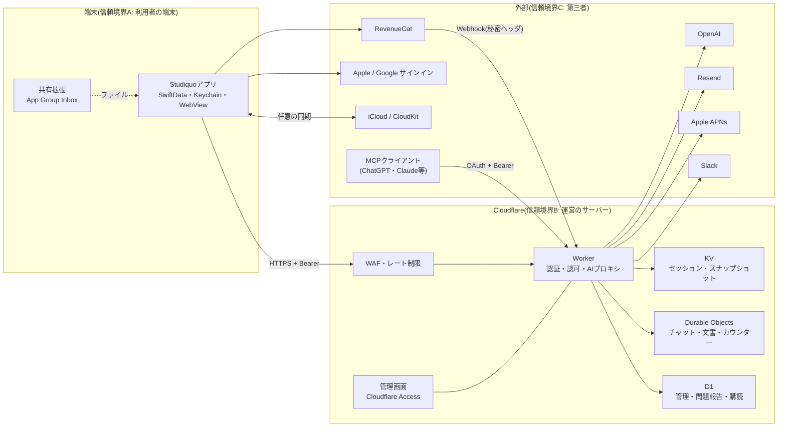

# Studiquo 脅威モデル

作成: 2026-10-18。対象: `main` の `b0c97f3` 時点のコードと、同日までに別ブランチで実装済み(未マージ)の変更。

この文書は、**攻撃者の目線でどこが狙われるか**を一か所にまとめたもの。設計の正本は[ARCHITECTURE.md](ARCHITECTURE.md)、データの分類と保存先は[SECURITY_AND_PRIVACY.md](SECURITY_AND_PRIVACY.md)、標準の要件との対応は[SECURITY_VERIFICATION.md](SECURITY_VERIFICATION.md)。ここでは重複を避け、**脅威・緩和の場所・残るリスク**だけを書く。

読み方:

- 「緩和」は、コードの場所とテスト名。テスト名は`mcp-server/src/*.test.js`(Worker)または`studiquoTests/`(アプリ)にある。
- 「状態」: **対応済み** / **一部** / **未対応** / **未マージ**(ブランチで実装済み、`main`には入っていない)。
- 「カード」は、Notionの「Studiquo タスク」にある残件の名前。
- 攻撃者の目線で足りない所は、責任者(あなた)が指摘して、§7に足す。

## 1. 守るもの

| 資産 | 例 | 漏れた/壊れたときの影響 |
|---|---|---|
| 学習資料 | ノート、手書き、PDF、暗記帳、文書、AIの会話 | 学生の私的な内容の漏えい。保護ノートは特に |
| アカウントとセッション | メール、Apple/Google ID、パスキー、Bearerトークン | なりすまし、他人の資料の閲覧 |
| 友達・チャット | フレンド関係、メッセージ、添付、グループ | 他人の会話の閲覧、いやがらせ |
| お金 | AIの利用料(OpenAI)、購読、メール送信の料金 | 金銭の損失、サービスの停止 |
| 秘密情報 | `OPENAI_API_KEY`、署名鍵、APNs鍵、Webhook秘密 | 上の全部。台帳は[RUNBOOK.md](RUNBOOK.md)付録A |
| 運営の信頼 | プライバシーポリシー、削除の約束 | 法的・評判の損失 |
| 稼働 | Worker、KV/D1/DOの1日の上限 | 全員の機能停止 |

## 2. 攻撃者

| 記号 | 攻撃者 | できること |
|---|---|---|
| X1 | 匿名のインターネット利用者 | 公開エンドポイントを叩く。公開リポジトリを読む。アカウントを大量に作る |
| X2 | 登録済みの悪意ある利用者 | 自分のトークンで、他人のID・ルーム・文書を試す。AIを大量に使う |
| X3 | 友達・グループの相手 | 招待リンク、共有された資料、チャットを悪用する |
| X4 | 他人の端末を触れる人(共用・盗難) | ロック画面、アプリスイッチャー、バックアップ、残ったセッションを見る |
| X5 | ネットワーク上の攻撃者 | 通信の盗聴・改ざん(公衆Wi-Fi) |
| X6 | 悪意あるアプリ・ファイル・ウェブページ | 同じURLスキームを登録する。悪意ある PDF・docx・画像を渡す |
| X7 | 連携先の侵害(OpenAI、Cloudflare、Resend、RevenueCat等) | 渡したデータの閲覧、偽の応答 |
| X8 | 運営側の誤操作・秘密の漏えい | 公開リポジトリへの秘密の混入、設定ミス |

**対象外**とするもの: 脱獄・改造した端末での耐性(MASVS-RESILIENCEの対象外、理由は[SECURITY_VERIFICATION.md](SECURITY_VERIFICATION.md))、国家レベルの攻撃者、Appleのプラットフォーム自体の脆弱性。

## 3. データフローと信頼境界

信頼境界の越え方(攻撃者が狙う入口):

1. **端末 → Worker**: HTTPS。入口で`MAINTENANCE_MODE`、レート制限、署名つきトークンの確認、実在セッションの確認、権限の確認の順に通す(`mcp-server/src/app.ts`、`app-gate.ts`)。
2. **外部 → Worker**: MCPクライアント(OAuth)、RevenueCatのWebhook(秘密ヘッダ)、管理画面(Cloudflare Accessのトークン)。
3. **Worker → 外部**: OpenAI(要約された範囲だけ)、Resend、APNs、Slack。受け取る側は信頼しない。
4. **端末の中**: アプリと共有拡張(App Group)、他アプリ(URLスキーム、ペーストボード、ファイル)、バックアップ。

## 4. 要素ごとのSTRIDE(要約)

S=なりすまし、T=改ざん、R=否認、I=情報漏えい、D=サービス拒否、E=権限昇格。

| 要素 | S | T | R | I | D | E |
|---|---|---|---|---|---|---|
| アプリ→Worker(Bearer) | 偽トークンは署名とKVの実在で拒否(`token-signature.ts`、`session.ts`) | TLS | 操作ログは最小 | 通信はTLS、平文httpは未対応(カード) | レート制限、`/mcp`は120回/分 | トークンは自分のアカウントに限る |
| サインイン(Apple/Google) | JWKS検証、audience・issuer・期限、nonce(`id-token-nonce.ts`) | — | — | — | 5回/分/IP | 別アカウントへのリンクは検証済みメールのみ(`oauth-links.ts`) |
| メール+パスワード | Argon2id、漏えいPW照合、失敗の待機(`login-throttle.ts`) | — | — | 同じ時間で応答(タイミング) | 同時Argon2を制限 | — |
| パスキー | WebAuthn、challenge | — | — | — | レート制限 | — |
| チャット/文書(DO) | メンバー確認 | ルーム単位 | — | 非メンバーの読み書き拒否(テスト多数) | 6MB/10回/分 | 招待は友達のみ |
| MCP(OAuth) | PKCE(S256)、redirect検証、コード1回 | — | — | トークンはハッシュ保存 | レート制限 | 範囲(scope)を限る |
| AIプロキシ | 実在セッション+同意+年齢 | プロンプト区切りの無害化 | — | `store:false`、本文をログに出さない | 窓ごとの上限+全体上限 | プランごとのモデル |
| スナップショット(KV) | — | — | — | AES-256-GCM(鍵設定時)、90日で削除 | 30回/時 | — |
| 管理画面 | Cloudflare Accessのトークン検証(失敗で閉じる) | 他サイトからの書き込みを拒否 | — | 本文・画像の閲覧は管理者のみ | — | `/api/admin/*`をWorker側でも検査 |
| 端末のデータ | — | — | — | 保護ノートはAES-GCM、Keychain | — | — |
| 共有拡張/URLスキーム | カスタムスキームは横取りされうる | — | — | トークンがURLに載る | — | — |

## 5. 悪用ケース

各ケース: 攻撃者→手口→影響→緩和(場所・テスト)→残るリスク→状態。

### A1. AI料金の食い潰し(X1, X2)
- **手口**: 大量のアカウント/トークンでAIを叩く。長い入力、画像、並列。
- **影響**: OpenAIの料金、他の利用者の枠が尽きる。
- **緩和**: 実在セッション必須、同意と年齢区分必須(`ai-privacy.ts`、テスト「a request without a confirmed age band is refused」)、1分60回/アカウント(`api-hardening.test.js`「AI requests are limited to 60 a minute per account before any body is read」)、窓ごとのクレジット上限と全体上限(`ai-credits.ts`、`ai-credits.test.js`)、無プランは本文を読む前に402、`AI_PROVIDER_APPROVED`(既定false)。
- **残る**: アカウントを大量に作られる(サインアップの自動化)。App Attest(カード「App Attest(サーバー側/iOS側)」)。上限に近づいたときの通知が無い(カード「異常検知のアラート」)。
- **状態**: 一部(App Attestは未マージ)。

### A2. アカウント乗っ取り(X1, X2, X5)
- **手口**: パスワードの総当たり・クレデンシャルスタッフィング、メール確認コードの総当たり、フィッシング(AiTM)、盗まれたIDトークンの再送、OAuthの連携で別アカウントに紐づける。
- **緩和**: Argon2id(`local-auth.ts`)、漏えいPW照合(`pwned-passwords.ts`)、失敗の段階的な待機(IP+メール、メール、ASNの3系統、`login-throttle.ts`)、確認コードは15分・5回で失効しハッシュ保存(`email-verification.test.js`)、Apple/Googleは署名・audience・issuer・期限・nonce(`apple-auth.test.js`、`google-auth.test.js`、`REQUIRE_ID_TOKEN_NONCE`)、連携は検証済みメールだけ(`oauth-links.ts`)、新しい環境のサインインはメール通知(`login-monitor.ts`)、パスキーの強制(`passkey-policy.ts`、テスト「the first sign-in without a passkey is refused, starts a recovery and tells the owner」)、パスワード変更で古いセッションを失効(`session-revocation.test.js`)。
- **残る**: パスワードの最小長が8(カード「パスワードの最小長」)。パスキー強制の配備と実機確認が未了(カード「AiTMフィッシング対策(パスキー強制)の配備判断と実機確認」)。**検証済みメールの所有権が人から人へ移る場合**(ドメインの失効後の再取得、会社・学校のアドレスの再割当)、そのアドレスで入った別人は、先着のオーナーの正規アカウントに紐づけられ、旧所有者のチャット・同期・課金・接続を引き継ぎうる(`oauth-links.ts`の`email-account-owner:`、`app.ts`の`canonicalIdentityKey`でセッションを発行)。Appleの非公開リレーのアドレスは別のアドレスとして扱われる(カード「検証済みメールの所有権が移ったときのアカウントの引き継ぎ」)。
- **状態**: 一部。

### A3. 他人の資料への到達(IDOR)(X2, X3)
- **手口**: 他人のルームID・文書ID・アバター・添付・MCP接続を推測/列挙して読む・書く。
- **緩和**: ルームのメンバー確認(`chat.test.js`「someone outside the room cannot look up messages in it」「someone outside the friendship cannot read or send in the room」「a stranger cannot download someone else's avatar」「someone who isn't a member of the group cannot upload its photo」)、文書の役割確認(`document-collab.test.js`「someone never invited cannot read room state」「a non-owner cannot invite」)、IDはサーバーが決める、KVのキーはトークンのハッシュ、アカウント間の漏れなし(`entitlements.test.js`「one account's subscription never leaks into another's lookup」、`account-deletion.test.js` 48)。
- **残る**: 新しい経路を足すたびに確認が要る(テストの網羅表が無い)。2026-10-22のAPI監査(`docs/API_SECURITY_AUDIT_2026-10-22.md`)で、ブロック/フレンド削除の判定が「メッセージ送信」にしか掛かっておらず、編集・添付・共有文書・招待の承諾が別々に判定されていた(AUTHZ-1〜4,7)。修正済みだが、判定が書き込みの全入口に通る共通の仕組みにはなっていない。未対応: DO(Durable Object)の無制限生成(AUTHZ-6)、文書の参加者一覧に内部のチャット鍵が出る(AUTHZ-8)、共有文書の除名・退出の画面(APIのみ)。
- **状態**: 一部(対応済みの経路は継続的な確認が必要。上の未対応が残る)。

### A4. フレンド招待リンクの悪用(X3, X6)
- **手口**: リンクを手に入れた人は、承認なしで招待者の友達になれる。招待ページが`studiquo://`へ転送し、同じスキームを登録した別アプリがトークンを受け取る。
- **緩和**: トークンは10文字(約50ビット)でレート制限付き(5回/分)、`https://…/invite`(Universal Link)を優先(`passkeys.ts`の`associationFile`)、アプリは確認ダイアログを経て追加。
- **残る**: トークンは永続・複数回使用・再生成不可。カスタムスキームの横取り。
- **状態**: 一部(招待ページの自動転送の廃止とonOpenURLの修正はブランチ`claude/net-server`・`claude/net-app`、**未マージ**。トークンの寿命はカード「フレンド招待…」)。

### A5. MCP連携(OAuth)の悪用(X1, X6)
- **手口**: 動的登録で偽のクライアント名を登録し、承認画面でだます。認可コード・リフレッシュトークンの再利用。外部AIアプリに過大な範囲を与える。
- **緩和**: PKCE(S256のみ)、redirect_uriは`https`または`localhost`だけで、認可時に完全一致(`mcp-oauth.ts`の`validRedirect`)、コード1回、リフレッシュの再利用で接続ごと失効(ログ「mcp refresh token reused; connection revoked」)、アクセストークン1時間、`mcp-oauth.test.js`(13)、利用者は設定から接続を解除できる(`api-hardening.test.js`「the list of connected apps shows only what the app displays」)。
- **残る**: 動的登録は誰でもできる。クライアント名は自己申告(カード「OAuth動的登録のクライアント名でのなりすまし対策」)。
- **状態**: 一部。

### A6. スナップショット(MCP用の写し)の漏えい(X7, X8)
- **手口**: KVを読める人(運営の誤操作、Cloudflare側の侵害)が、ノート・文書・予定の写しを読む。
- **緩和**: AES-256-GCM、鍵名をAADに束縛(`snapshot-crypto.test.js`「a ciphertext moved to another key name does not open」)、最終同期から90日で自動削除、`SNAPSHOT_ENCRYPTION_REQUIRED`。
- **残る**: 鍵が未設定だと平文で保存される。配備と鍵の設定が未了(カード「スナップショット暗号化…の配備」)。
- **状態**: 一部。

### A7. 退会と再登録(X2)
- **手口**: 退会後も残るデータ、再登録で過去の課金・資料が混ざる、削除の途中失敗。
- **緩和**: 永続の削除ジョブ(再試行可能)、世代管理(`session.ts`の`generationOf`)、全identityのalias削除、RevenueCat顧客削除の再試行、`account-deletion.test.js`(46以上のケース)。
- **残る**: 外部サービス(OpenAI等)に渡った分、iCloud上のデータは削除されない(ポリシーに記載)。CloudKit上の削除は実機での確認が未了(カード「CloudKitの実機確認」)。
- **状態**: 一部。

### A8. 管理画面・Webhookの偽装(X1)
- **手口**: `/api/admin/*`を直接叩く。偽の購入イベントを送る。他サイトから管理操作をさせる。
- **緩和**: Cloudflare Accessのトークンを毎回検証し、設定が無ければ拒否(`access.ts`の「Fails closed」)、他サイトからの書き込みを拒否(`isCrossSiteWrite`、`low-priority-hardening.test.js`)、Webhookは秘密ヘッダの定数時間比較(`admin.test.js`「a webhook with a missing/wrong Authorization header is rejected with 401」)、管理画面のCSP/フレーム禁止(`api-hardening.test.js`)。
- Webhookの重複配信は`event.id`で無視し(`INSERT OR IGNORE`)、古い更新で新しい状態を上書きしない(`updated_at`の比較)。管理画面の表示は利用者入力を`textContent`で出し、`innerHTML`は数値だけ(`admin-inbox-ui.ts`、`admin.ts`)。
- **残る**: Webhook秘密が漏れると、任意の購読者IDに課金状態を付与でき、`event_timestamp_ms`は送る側の指定値なので、再送や過去日時での上書きも攻撃者の都合になる。失効手順は付録Aにあるが、訓練していない。
- **状態**: 対応済み。

### A9. メール送信・プッシュ送信の悪用(X1)
- **手口**: 確認コードの送信を連打して、Resendの料金や評判を損なう。他人に迷惑メールを送る。プッシュで偽の通知を送る。
- **緩和**: 送信のレート制限(5回/分/IP)に加えて、**宛先のメールアドレスごとの上限**(`app.ts`の`EMAIL_SEND_LIMIT_PER_WINDOW`=5、`withinEmailCodeBudget`)があり、多数のIPからでも同じ宛先への爆撃は窓内5通に収まる。応答は常に`{sent:true}`で、アドレスの存在は分からない。プッシュは友達関係が前提。`DISABLED_FEATURES`で個別に止められる(ブランチ`claude/kill-switch-server`、**未マージ**)。
- **残る**: 宛先を変え続ける送信量(Resendの料金)。送信量の異常を知らせる仕組みが無い。DMARCが無く、なりすましメールを拒否できない(カード「ドメインのDNS設定」)。
- **状態**: 一部。

### A10. 端末を触れる人(X4)
- **手口**: 共用端末で残ったセッション、アプリスイッチャーの画像、ペーストボード、バックアップ、ロック画面の通知プレビュー。
- **緩和**: 保護ノートはAES-GCMで暗号化し、生体認証/パスコードの後にだけ復号(`NotebookEncryptionService`、`NotebookEncryptionServiceTests`)、バックグラウンドで再封印、セッションはKeychain(`AfterFirstUnlockThisDeviceOnly`)、ログアウトでサーバーのトークンを失効、退会で端末データを消去。
- **残る**: 鍵の上書きで保護ノートが読めなくなるおそれ、アプリスイッチャー、接続トークンのコピー、ブラウザの閲覧データ、ロック画面のプレビュー、SwiftDataのData Protection。いずれもブランチで実装済み(`claude/key-safety`、`claude/switcher-privacy`、`claude/net-app`)で**未マージ**。ロック画面のプレビューを隠す設定は未実装(`SECURITY_AND_PRIVACY.md` P2-10)。
- **状態**: 一部(未マージが多い)。

### A11. 悪意あるファイルの取り込み(X6)
- **手口**: ZIP爆弾のdocx、巨大なPDF、解像度を偽った画像でメモリを使い切る。
- **緩和**: docxの1エントリ100MB上限(`DocxZipTests`)。
- **残る**: 全体の上限、PDFのページ数、画像の画素数の確認が`main`には無い。
- **状態**: 未マージ(ブランチ`claude/import-hardening`で実装、`ImportLimitsTests`)。

### A12. 通信の盗聴・改ざん(X5)
- **緩和**: ATSに例外なし、Releaseは`api.studiquo.app`のhttpsのみ(`WorkerEndpointPolicyTests`)。
- **残る**: サーバーが平文httpを受け付け、HSTSが無い(外部クライアント向け)。証明書のピン留めはしない(§6の判断)。
- **状態**: 一部(HSTSと平文httpの拒否はブランチ`claude/net-server`、**未マージ**。Cloudflareの「Always Use HTTPS」はあなたの設定)。

### A13. 運営側の誤操作・秘密の漏えい(X8)
- **手口**: 秘密を公開リポジトリに押す。本番とステージングの取り違え。設定ミス。
- **緩和**: 秘密スキャン(gitleaks、trufflehog、`scripts/secret-scan.sh`)、GitHubのsecret scanningとpush protection、署名つきトークン・nonceの段階配備フラグ、`wrangler.jsonc`のステージング分離。
- **残る**: **リポジトリが公開**、CIとブランチ保護が無い、秘密の台帳と訓練が無い。KVの`preview_id`が本番と共通(`RUNBOOK.md`共通の禁止事項)。
- **状態**: 一部(CI・台帳はブランチ`claude/ci-setup`、**未マージ**)。

### A14. 稼働の妨害(X1, X2)
- **手口**: 連打で1日の上限(KV/DOの操作数)を使い切り、全員を止める。
- **緩和**: WAFのIPごとの制限(10秒に200件)、署名つきトークンで偽トークンはKVを読まずに拒否(`token-signature.test.js`「a flood of invented tokens, each different, still costs no KV read」)、`MAINTENANCE_MODE`、機能別の停止(未マージ)。
- **残る**: 多数のIPからの連打、正規トークンでの連打。外部の稼働監視が無い(カード「外部の稼働監視」)。
- **状態**: 一部。

### A15. 公開リポジトリからの情報収集(X1)
- **手口**: ソース・運用手順書・識別子から、弱点と手順を調べる。
- **緩和**: 秘密は含めない運用(スキャン)。
- **残る**: 公開が意図かの判断が未了(カード「GitHubリポジトリが公開」)。SECURITY.mdと報告窓口が無い(カード「security.txt」)。
- **状態**: 一部。

### A16. 依存パッケージの汚染(X7, X8)
- **手口**: npm(Worker)やSwiftPM(アプリ)の依存に悪意あるコード、既知の脆弱性。
- **緩和**: 依存が少ない(Worker 5つ、アプリ3つ)。`npm audit`を手動で実行。Swiftの依存は範囲指定(GoogleSignIn・RevenueCat)かコミット固定(SwiftMath)。
- **残る**: 自動の監視が無い。
- **状態**: 一部(CI・Dependabotはブランチ`claude/ci-setup`、**未マージ**)。

### A17. プッシュトークンの奪取(X2)
- **手口**: 他人のAPNsトークンを知っている人が、自分のアカウントで同じトークンを登録する。登録は後勝ちで、前の持ち主から外れる(`devices.ts`)。
- **影響**: 被害者の通知が止まり、攻撃者に届く。
- **緩和**: トークンは推測できない(漏えいが前提)。新しい端末の登録は、既存の端末へ通知される(`devices.test.js`「registering a genuinely new installation alerts the account's existing device only」)。
- **状態**: 一部(漏えいが前提のため低い)。

### 該当しないもの(確認済み)
- **WebSocket・リアルタイム接続**: Workerのコードに無い。チャット・共同編集はHTTPのポーリング/取得。
- **セッション固定**: トークンはサーバーが発行する(`mintSession`)。クライアント指定の値は使わない(`session.test.js`「the secret half of a token comes from the Worker…」)。
- **メールアドレスの列挙**: ログインは一律の失敗応答で、ダミーのハッシュ計算で時間もそろえる(`local-auth.test.js`)。確認コードの送信は常に`{sent:true}`。

## 6. 意図的に対象外・保留にしている対策

| 項目 | 判断 | 理由 |
|---|---|---|
| 証明書のピン留め | しない | 証明書はCloudflareが更新する。ピン留めの誤りは全員の接続不能を招く。ATSとhttps固定で足りる脅威モデル |
| 脱獄検知・難読化 | しない | 端末の所有者が攻撃者の場合は守れない。学習アプリの資産に対して費用が見合わない |
| 保護ノートの鍵の生体認証への結合 | 保留 | iCloud Keychainで端末間同期する設計と両立しない。ゼロ知識暗号ではないとポリシーに明記(`SECURITY_AND_PRIVACY.md`) |
| サーバー側のチャット本文の暗号化 | 保留 | 検索・通知・通報の機能と両立が難しい。保管場所の保護はCloudflareに依存 |

## 7. 残るリスクの一覧(カードにしたもの)

「満たさない」「一部」と判断して、Notionにカードを作ったものは[SECURITY_VERIFICATION.md](SECURITY_VERIFICATION.md)の§5にまとめてある。ここでは重複を避けるため、再掲しない。

## 8. 更新のしかた

- 新しいエンドポイント、連携先、保存するデータを足すときは、§3の図と§4の表、§5の該当ケースを同じ変更で更新する。
- インシデントのあと、原因となった攻撃をケースとして足し、緩和とテストの場所を書く([RUNBOOK.md](RUNBOOK.md)の対応記録と対応させる)。
- 責任者のレビューで攻撃者の目線の指摘があれば、§5に足す。半年ごとに全体を見直す。
